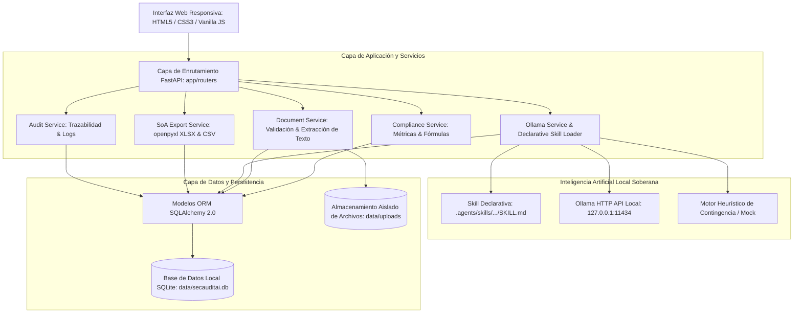
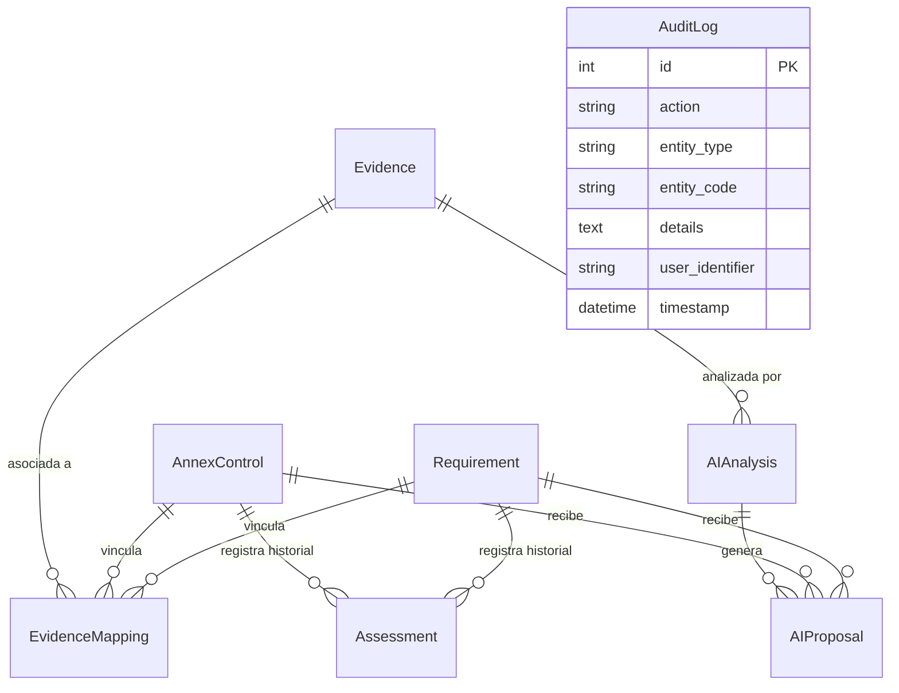

# SecAuditAI &mdash; Arquitectura del Sistema

## 1. Visión General
**SecAuditAI** es una plataforma de software modular diseñada para la evaluación, documentación y gestión del cumplimiento del estándar **ISO/IEC 27001:2022** (incluyendo la **Enmienda 1:2024** relativa a consideraciones de cambio climático en las cláusulas 4.1 y 4.2), asistida por modelos de lenguaje de inteligencia artificial ejecutados de forma soberana y local mediante **Ollama**.

El sistema prioriza la seguridad en la capa de aplicación (AppSec), la trazabilidad exhaustiva de decisiones y la estricta separación entre las sugerencias de la IA y las determinaciones oficiales de los auditores humanos.

---

## 2. Diagrama de Arquitectura por Capas

---

## 3. Componentes Principales

### 3.1 Capa Web y Presentación (`app/templates`, `app/static`, `app/routers`)
- **Tecnologías**: Jinja2, HTML5 semántico, CSS3 nativo (sin dependencias de CDN externas ni conexión a internet requerida), JavaScript ligero.
- **Vistas Principales**:
  - `Dashboard`: Indicadores clave, progreso global, desglose por cláusula y tema del Anexo A, alertas y bitácora.
  - `Cláusulas 4 a 10`: Catálogo navegable de 30 subcláusulas, formulario de evaluación, historial y evidencias asociadas.
  - `Controles Anexo A`: Catálogo de 93 controles de ISO/IEC 27001:2022 agrupados por tema (Organizacional, Personas, Físico, Tecnológico).
  - `Declaración de Aplicabilidad (SoA)`: Matriz interactiva de los 93 controles con justificaciones de inclusión/exclusión y descarga en Excel (XLSX) y CSV.
  - `Evidencias`: Carga segura de documentos (PDF, DOCX, TXT, MD), extracción de texto, cálculo de SHA-256 e inicio de análisis con IA.
  - `Bandeja de Propuestas IA`: Bandeja de supervisión humana donde el auditor acepta, modifica o rechaza las sugerencias generadas.
  - `Configuración Ollama`: Estado del servicio local, modelos disponibles y visualización de la Skill declarativa.

### 3.2 Capa de Servicios (`app/services`)
- **`compliance_service.py`**:
  Calcula dinámicamente las métricas del SGSI consultando directamente la base de datos.
  
  **Fórmula Documentada de Cumplimiento**:
  $$\text{Porcentaje Global} = \frac{\sum \text{Puntuaciones de Requisitos Evaluados}}{\text{Requisitos Evaluados} \times 5} \times 100$$
  
  - **Exclusión de No Evaluados y No Aplicables**:
    - Los requisitos con nivel 0 (*No evaluado*) no suman puntos ni penalizan el denominador.
    - Los requisitos con nivel -1 (*No aplicable*) se excluyen estrictamente del denominador para no computar como incumplimientos.
    - El denominador muestra siempre la cantidad de elementos evaluados y la puntuación máxima alcanzable (ej. `32 / 40 pts (8 evaluados)`).

- **`document_service.py`**:
  - Valida el tamaño (máximo configurable, por defecto 15 MB).
  - Valida la extensión y la firma interna (*magic bytes*) de los archivos (ej. `%PDF` para PDF, `PK\x03\x04` para DOCX).
  - Previene *Path Traversal* generando nombres basados en UUID y verificando la contención de directorios mediante `is_path_safe()`.
  - Extrae texto digital mediante `pypdf` y `python-docx`. Si un PDF es escaneado y no contiene texto, lo informa expresamente sin inventar contenido.

- **`ollama_service.py`**:
  - Carga el procedimiento declarativo definido en `.agents/skills/iso27001-evidence-review/SKILL.md` (separando frontmatter YAML del cuerpo Markdown).
  - Sanitiza el texto del documento mediante `defend_prompt_injection()` aislándolo entre delimitadores seguros.
  - Ejecuta la llamada local a `http://127.0.0.1:11434/api/chat` en modo JSON (`format: "json"`).
  - Valida la respuesta estructurada mediante esquemas Pydantic (`AIAnalysisOutput`).
  - Si Ollama no está en ejecución o el modelo no está descargado, conmuta automáticamente a un motor determinista simulado que permite continuar las pruebas y la auditoría.
  - **Principio de No Sobrescritura**: Registra las propuestas de la IA de forma separada sin alterar silenciosamente las evaluaciones humanas existentes.

- **`soa_service.py`**:
  - Genera archivos Excel (.xlsx) con estilos profesionales usando `openpyxl`: cabecera corporativa `#1E293B`, bordes finos, autoajuste de columnas y marcado de estado.
  - Genera archivos CSV codificados en UTF-8 con BOM (`utf-8-sig`) para compatibilidad inmediata con hojas de cálculo.

- **`audit_service.py`**:
  - Registra toda acción de cambio de estado, carga de evidencias o resolución de propuestas en la tabla `AuditLog`.

---

## 4. Modelo de Datos Relacional (SQLAlchemy 2.0)

### Entidades Principales:
1. **`Requirement`**: Representa las 30 subcláusulas de los capítulos 4 al 10. Almacena la puntuación oficial interna (0 a 5 o -1 para NA), justificación, observaciones y responsable.
2. **`AnnexControl`**: Representa los 93 controles oficiales del Anexo A de ISO/IEC 27001:2022. Almacena la decisión de aplicabilidad (SoA), justificación de inclusión, justificación de exclusión, estado de implementación, nivel de madurez y confirmación humana.
3. **`Evidence`**: Metadatos de archivos (nombre original, nombre interno UUID, ruta en disco, tamaño, MIME type, hash SHA-256, texto extraído y estado).
4. **`EvidenceMapping`**: Relación n-a-n entre una evidencia y los requisitos o controles (indicando si el vínculo fue realizado por un usuario humano o sugerido por la IA).
5. **`AIAnalysis`**: Registro del análisis ejecutado por Ollama, incluyendo resumen, fortalezas, brechas, recomendaciones y faltantes.
6. **`AIProposal`**: Propuesta específica emitida por la IA para un requisito o control. Permanece en estado `pending` hasta ser aprobada, modificada o rechazada por el auditor.
7. **`Assessment`**: Registro histórico de cada evaluación realizada (puntuación anterior, puntuación nueva, justificación y auditor).
8. **`AuditLog`**: Registro de auditoría y trazabilidad del sistema.
